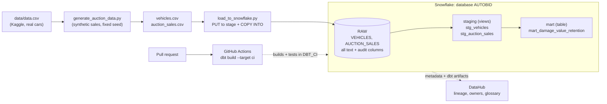

# AutoBid Data Platform

A small, governed data pipeline for vehicle auction analytics:
**raw CSVs → Snowflake → dbt (clean, test, document) → one business mart**, with CI tests on
every pull request and lineage/ownership in DataHub.

## The problem

An online vehicle auction company gets new data every day: cars arriving at yards, lots listed,
bids, cars sold. Raw data is messy, so analysts don't trust the numbers, and pipeline changes break
dashboards quietly.

**Business question:** how much value does a car keep after damage, and which damage types sell
best at auction?

## Architecture



| Layer | Tool | Where |
| --- | --- | --- |
| Warehouse | Snowflake (X-Small, auto-suspend 60s, 20-credit monitor) | [snowflake/setup.sql](snowflake/setup.sql) |
| Data generation | Python (standard library only) | [scripts/generate_auction_data.py](scripts/generate_auction_data.py) |
| Load | Python + Snowflake connector, `PUT` + `COPY INTO` | [scripts/load_to_snowflake.py](scripts/load_to_snowflake.py) |
| Transform, test, document | dbt Core 1.12 (`dbt-snowflake`) | [autobid_dbt/](autobid_dbt/) |
| Orchestration | Apache Airflow 3.3 (`airflow standalone`, own venv) | [airflow/dags/autobid_daily.py](airflow/dags/autobid_daily.py) |
| CI/CD | GitHub Actions + branch protection on `main` | [.github/workflows/dbt_ci.yml](.github/workflows/dbt_ci.yml) |
| Catalog, lineage, ownership | DataHub (open source, local Docker) | [datahub/](datahub/) |

### Snowflake layout

| Schema | Contents | Written by |
| --- | --- | --- |
| `RAW` | `VEHICLES`, `AUCTION_SALES` exactly as loaded (all text, plus `_SOURCE_FILE`, `_LOADED_AT`) | load script |
| `DBT_PRERNA` | dev build of all dbt models | dbt `--target dev` |
| `DBT_CI` | CI build of all dbt models | GitHub Actions |
| `ANALYTICS` | production build | dbt `--target prod` |

Security: code never runs as `ACCOUNTADMIN`. The load script, dbt and CI log in as service user
`DBT_SVC` (`TYPE = SERVICE`, key-pair auth, no password) with role `AUTOBID_ROLE`, which can only
use one warehouse and create objects in the `AUTOBID` database. No secret is in this repo: the
private key lives in `~/.snowflake/` locally and in GitHub Secrets for CI.

## The data

- **Cars (real):** 1,000 cars sampled from the Kaggle
  [Car Features and MSRP](https://www.kaggle.com/datasets/CooperUnion/cardataset) dataset
  (11,914 rows). Cars built before 2000 or with the placeholder MSRP of $2,000 are excluded
  (1,554 rows), leaving 10,360 eligible cars.
- **Auction sales (synthetic):** real auction data is not public, so sales are generated with a
  fixed seed (same files every run). About 1,400 listings: each car is listed once, and an unsold
  car is relisted 14 days later, up to 3 tries.
  - Damage type and title type belong to the car, not the listing.
  - **Sale price = MSRP × age factor × damage share × title discount × noise**, where the age
    factor is 0.88^age (floor 0.15), damage share runs from 0.75 (Minor Dents/Scratches) to 0.20
    (Flood), Salvage titles sell for 20% less, and noise is about ±15%. Unsold lots have no price.
- **Bad batch:** [data/bad_batch/auction_sales_bad.csv](data/bad_batch/auction_sales_bad.csv)
  has one row for each problem: negative price, duplicate `sale_id`, unknown `vehicle_id`, unknown
  damage type. Used only to show that the tests catch bad data.

## dbt models

| Model | Type | What it does |
| --- | --- | --- |
| `stg_vehicles` | view | Renames to snake_case, casts types, trims text, `'N/A'` → NULL |
| `stg_auction_sales` | view | Same cleanup; `is_sold` text → boolean. Keeps bad rows so tests can see them |
| `mart_damage_value_retention` | table | One row per damage type: lots listed/sold, sell-through %, avg sale price, avg MSRP, **avg value retained %** |

**Value Retained** = for each sold car, `sale_price / msrp`; the mart reports the average of those
× 100, so every car counts equally whatever its price.

All SQL is portable (no Snowflake-only functions), so the same project can run on BigQuery.

### Tests (17 data tests, run on every `dbt build`)

- `unique` + `not_null` on every key (`vehicle_id`, `vin`, `sale_id`, mart `damage_type`)
- `accepted_values` on `damage_type` (7 values) and `title_type` (Clean, Salvage)
- `relationships`: every sale's `vehicle_id` exists in `stg_vehicles`
- singular test [assert_sale_price_positive.sql](autobid_dbt/tests/assert_sale_price_positive.sql):
  every sold lot has a price above 0

Every model and key column has a description, and every model has `meta: owner: prerna`.

## Results

| Damage type | Value retained | Sell-through | Avg sale price | Avg MSRP |
| --- | --- | --- | --- | --- |
| Minor Dents/Scratches | 19.0% | 84.5% | $8,753 | $45,735 |
| Hail | 14.3% | 81.0% | $5,673 | $40,745 |
| Rear End | 11.1% | 70.6% | $5,434 | $48,940 |
| Side | 9.9% | 66.2% | $4,743 | $47,031 |
| Mechanical | 9.7% | 60.4% | $5,194 | $55,016 |
| Front End | 8.0% | 69.8% | $3,479 | $42,966 |
| Flood | 4.2% | 46.9% | $2,325 | $57,066 |

Cosmetic damage (dents, hail) keeps the most value and sells most reliably; flood is worst on both.
Because sales are synthetic, this shows the method, not a real market finding. The numbers were
checked against an independent Python calculation on the source CSVs, and the mart's totals
(1,400 listed, 964 sold) match staging exactly.

## Bad data is caught, not published

Loading the bad batch on top of the clean data (`load_to_snowflake.py --bad-batch`) and running
`dbt build`:

```
FAIL 1 unique_stg_auction_sales_sale_id                    <- duplicate sale_id
FAIL 1 relationships_stg_auction_sales_vehicle_id__...     <- unknown vehicle_id
FAIL 1 accepted_values_stg_auction_sales_damage_type__...  <- damage type "Fire"
FAIL 1 assert_sale_price_positive                          <- price of -500
SKIP   relation DBT_PRERNA.mart_damage_value_retention
Done. PASS=13 WARN=0 ERROR=4 SKIP=3 TOTAL=20
```

Each bad row is caught by exactly one test, and the mart is **skipped**, so dashboards keep reading
the last good version instead of wrong numbers. After reloading clean data: `PASS=20`.

## CI and branch protection

On every pull request to `main`, [GitHub Actions](.github/workflows/dbt_ci.yml) installs the
pinned dbt version, writes a dbt profile from GitHub Secrets (`SNOWFLAKE_ACCOUNT`,
`SNOWFLAKE_USER`, `SNOWFLAKE_PRIVATE_KEY`) and runs `dbt build --target ci` into schema `DBT_CI`.
Branch protection on `main` requires a pull request and a passing `dbt-build` check, with no
bypass for admins, so a change that breaks a model or a test can't be merged.

## Daily orchestration (Airflow)

[airflow/dags/autobid_daily.py](airflow/dags/autobid_daily.py) runs the pipeline once a day as three
tasks in order: `generate_data` → `load_to_snowflake` → `dbt_build` (`dbt build --target prod`, into
schema `ANALYTICS`). Each task calls the same script or command we run by hand, using the project's
`.venv`. Settings: `catchup=False` (no backfilling of missed days), `max_active_runs=1` (two runs can't
overwrite each other's data), one retry per task (every task is safe to re-run). A failing dbt test
fails the run, so bad data never reaches `ANALYTICS`.

First real run: all three tasks succeeded on the first try in 25 seconds, and dbt reported `PASS=20`
on the prod target.

Airflow lives in its own virtual environment (`.venv-airflow`, installed with Airflow's official
constraints file) because its dependencies clash with dbt's. Only `airflow/dags/` is committed; the
local database, logs and config are gitignored.

```bash
python3.12 -m venv .venv-airflow
.venv-airflow/bin/pip install "apache-airflow==3.3.2" \
  --constraint https://raw.githubusercontent.com/apache/airflow/constraints-3.3.2/constraints-3.12.txt
export PATH=$PWD/.venv-airflow/bin:$PATH AIRFLOW_HOME=$PWD/airflow AIRFLOW__CORE__LOAD_EXAMPLES=False
export SNOWFLAKE_ACCOUNT=<account> SNOWFLAKE_USER=DBT_SVC SNOWFLAKE_PRIVATE_KEY_FILE=$HOME/.snowflake/dbt_svc_key.p8
airflow standalone        # UI at http://localhost:8080; don't run it at the same time as DataHub
```

## How to run it

Prerequisites: Python 3.12, a Snowflake account. One-time setup:

1. Create a key pair for the service user (outside the repo):
   ```bash
   mkdir -p ~/.snowflake && chmod 700 ~/.snowflake
   openssl genrsa 2048 | openssl pkcs8 -topk8 -nocrypt -out ~/.snowflake/dbt_svc_key.p8
   openssl rsa -in ~/.snowflake/dbt_svc_key.p8 -pubout -out ~/.snowflake/dbt_svc_key.pub
   ```
2. Run [snowflake/setup.sql](snowflake/setup.sql) in Snowsight as `ACCOUNTADMIN`, pasting the
   public key (without the BEGIN/END lines) into the placeholder.
3. Python environment:
   ```bash
   python3.12 -m venv .venv && source .venv/bin/activate
   pip install -r requirements.txt
   ```
4. dbt profile at `~/.dbt/profiles.yml` (profile `autobid`; targets `dev` → schema `DBT_PRERNA`,
   `ci` → `DBT_CI`, `prod` → `ANALYTICS`; `private_key_path` must be a full path, since dbt does not
   expand `~`).

Run the pipeline:

```bash
export SNOWFLAKE_ACCOUNT=<account> SNOWFLAKE_USER=DBT_SVC
export SNOWFLAKE_PRIVATE_KEY_FILE=~/.snowflake/dbt_svc_key.p8

python scripts/generate_auction_data.py     # writes data/generated/*.csv
python scripts/load_to_snowflake.py         # full reload of RAW
cd autobid_dbt && dbt build                 # staging + mart + 17 tests
```

Keep the repo out of iCloud-synced folders (Desktop/Documents): offloaded files make Python and
dbt hang with no error.

## How this would grow in production

Not built here on purpose (small, free project), but this is the next step for each:

- **Incremental models:** load and transform only new files and rows instead of a full reload,
  once data reaches millions of rows (dbt `incremental` materialization plus Snowflake's COPY load
  history).
- **Databricks / Spark:** for very large or semi-structured data (images of damaged cars, bid
  streams), with the same dbt project via `dbt-databricks`.
- **Semantic layer (Omni, Looker, ThoughtSpot):** define "Value Retained" and "Sell-through" once,
  so every dashboard computes them the same way.
- **Agentic analytics:** let an AI assistant answer questions from the documented, tested mart and
  DataHub's metadata instead of raw tables.
- **Data retention and archiving:** expire old RAW loads and stage files on a schedule, and keep
  history with Snowflake Time Travel and snapshots.
- **More checks:** source freshness on `_LOADED_AT`, row-count anomaly alerts, and a separate CI
  schema per pull request so parallel PRs can't clash.
